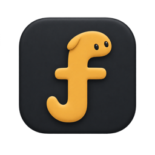
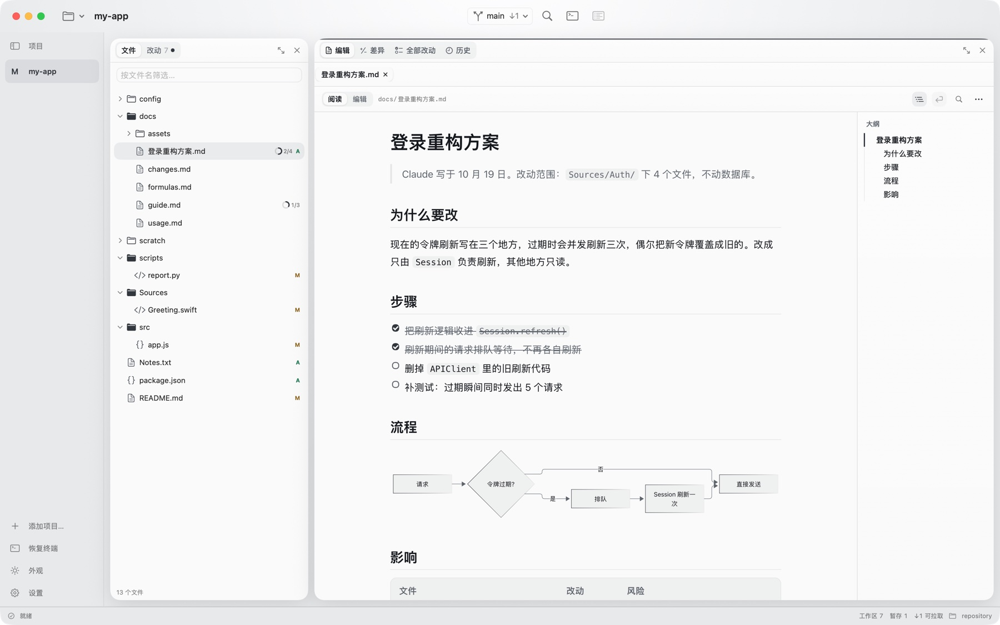

<div align="center">



# Folmi

**看清 AI 改了什么，一处一处决定留不留。**

用 Folmi 在 Mac 上审阅 Claude Code、Codex 或其他工具改过的代码。按行或按块收下改动，写评论交给 agent 继续改，再用熟悉的 Git 流程提交。

[](https://folmi.mindmesh.site/#download)

[](https://github.com/fieai/Folmi/releases)
[](LICENSE)

[下载 macOS 版](https://folmi.mindmesh.site/#download) · [GitHub Releases](https://github.com/fieai/Folmi/releases) · [快速开始](#快速开始) · [从源码构建](#从源码构建) · [更新记录](CHANGELOG.md)

</div>

<picture>
  <source media="(prefers-color-scheme: dark)" srcset="site/assets/shot-graphite-dark.jpg">
  
</picture>

## 快速开始

1. 从[官网](https://folmi.mindmesh.site/#download)或 [GitHub Releases](https://github.com/fieai/Folmi/releases)下载 DMG，把 Folmi 拖进「应用程序」。需要 Apple Silicon Mac 和 macOS 14 或更新版本。
2. 在「文件」菜单选「创建演示仓库」试用，或者按 <kbd>⌘O</kbd> 打开自己的 Git 仓库。
3. 打开「全部改动」，按下面的快捷键验收。**收下就是 Git 暂存**，处理完可以直接检查暂存区再提交。
4. 使用 Claude Code 或 Codex 时，可在打开仓库后按 <kbd>⌘K</kbd>，选「接入 agent…」，按提示配置钩子和 MCP。接入后可以按 AI 的轮次查看改动。

| 按键 | 动作 |
| --- | --- |
| <kbd>Space</kbd> | 看下一处 |
| <kbd>Return</kbd> | 收下这一处 |
| <kbd>Delete</kbd> | 丢弃这一处 |
| <kbd>⌘Z</kbd> | 撤销上一步验收 |

> [!NOTE]
> 预发布版使用 Developer ID 签名，尚未完成 Apple 公证。可以用 `shasum -a 256` 对照 Release 中的校验值。如果 macOS 阻止打开，前往「系统设置 → 隐私与安全性」，选择「仍要打开」。

## 功能

- **验收改动**。优先看依赖、构建脚本、配置和大段删除。支持并排差异、连续浏览、按行或按块暂存，以及撤销验收操作。
- **把反馈交给 agent**。针对具体代码提问，把带文件和行号的评论发给 agent。接入 Claude Code 或 Codex 后可以按轮次看改动，在改动可安全恢复时整批撤回。
- **阅读和编辑 Markdown**。阅读视图支持 KaTeX、Mermaid 和大纲，在项目中可以一边编辑一边预览，也能查看渲染后的差异。
- **直接打开文件和文件夹**。按 <kbd>⌥⌘O</kbd> 在独立窗口打开 Markdown 或其他文本文件。在系统设置中启用 Folmi 的 Finder 扩展后，可从 Finder 右键菜单打开文件和文件夹。Git 文件夹会打开对应项目，普通文件夹可直接浏览。
- **完成日常 Git 操作**。在内嵌终端里运行命令，或在 Folmi 中检查暂存区、提交、拉取、推送、处理冲突和查看历史。

## 从源码构建

使用 Apple Silicon Mac、Xcode 26 或更新版本，以及 Xcode 的 Metal 工具链。Metal 工具链可通过 Xcode 的组件设置或 `xcodebuild -downloadComponent MetalToolchain` 安装。

```sh
git clone https://github.com/fieai/Folmi.git
cd Folmi
swift build
./scripts/test.sh
./scripts/build-app.sh
open dist/Folmi.app
```

打包脚本优先使用本机的 Apple Development 证书，否则使用 ad-hoc 签名。想在独立配置中试用演示仓库，可以运行：

```sh
./scripts/build-app.sh --editor-preview
open -n dist/Folmi-EditorPreview.app --args --demo --workspace-file /tmp/Folmi-Demo/workspace.json
```

| 路径 | 内容 |
| --- | --- |
| [Sources/Folmi](Sources/Folmi) | SwiftUI 和 AppKit 界面 |
| [Sources/FolmiCore](Sources/FolmiCore) | Git 操作、差异、AI 事件和 MCP 服务 |
| [Sources/FolmiHook](Sources/FolmiHook) | Claude Code 和 Codex 的钩子、MCP 入口 |
| [Sources/FolmiCLI](Sources/FolmiCLI) | `folmi` 终端命令 |
| [Sources/FolmiFinderExtension](Sources/FolmiFinderExtension) | Finder 右键菜单 |
| [Tests](Tests) | 核心和 App 测试 |

## 数据与隐私

- 验收以 Git 工作区和暂存区为准。AI 轮次记录和审阅评论存放在项目的 Git 元数据目录中。
- 本机设置保存在 `~/Library/Application Support/Folmi/`，API Key 存在系统钥匙串。
- 使用 AI 解释改动或生成提交说明时，相关内容会交给你配置的模型或本机 Claude Code。接入 agent 时，Folmi 会在你确认后写入钩子和 MCP 配置。

## 参与贡献

欢迎提 [Issue](https://github.com/fieai/Folmi/issues) 或 Pull Request。报告问题时可以附上 Folmi 和 macOS 版本、复现步骤，以及可以公开的截图。开始较大的改动前，可以先看 [产品方向](docs/direction.md)。

提交前可运行 `SKIP_PERF=1 ./scripts/check.sh`，检查编译、测试和打包。App 测试会打开本机窗口，GitHub CI 负责构建和核心测试。维护者有性能测试用仓库时，可以运行完整的 `./scripts/check.sh`。

维护者发布新版本时，在 [CHANGELOG.md](CHANGELOG.md) 的「未发布」下补充用户能感知的改动，运行 `python3 scripts/site-changelog.py` 更新官网，再使用 `./scripts/ship.sh`。官网发布和 Developer ID 签名依赖发版机器上的配置。

## 许可与致谢

Folmi 采用 [MIT 许可证](LICENSE)。感谢 [SwiftTerm](https://github.com/migueldeicaza/SwiftTerm)、[KaTeX](https://katex.org)、[Mermaid](https://mermaid.js.org)、[Fusion Pixel](https://github.com/TakWolf/fusion-pixel-font) 和 [One Dark Pro](https://github.com/Binaryify/OneDark-Pro)。第三方许可见 [licenses/](licenses/)。
