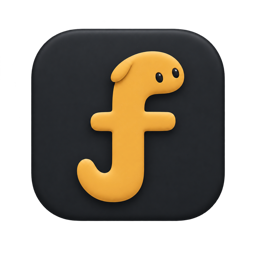
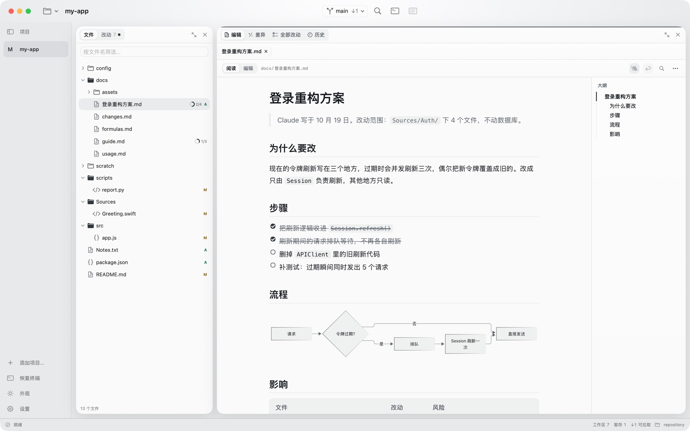
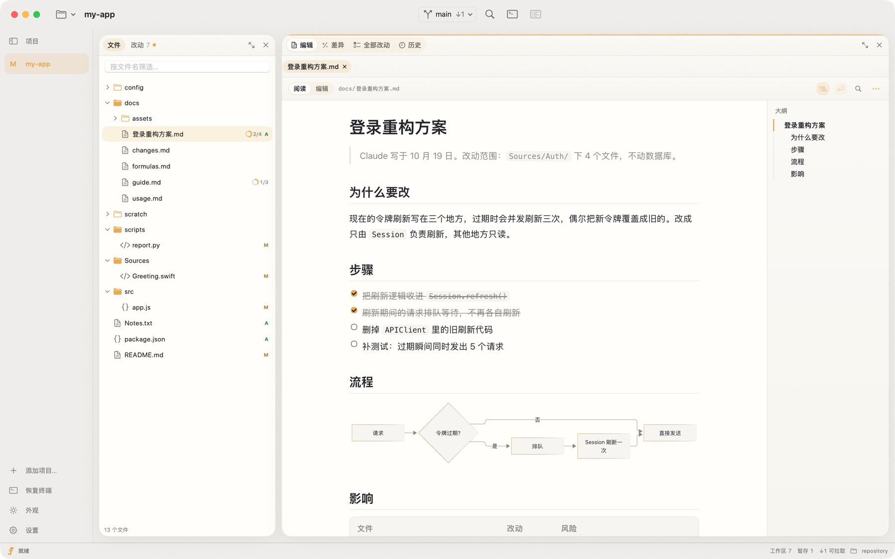
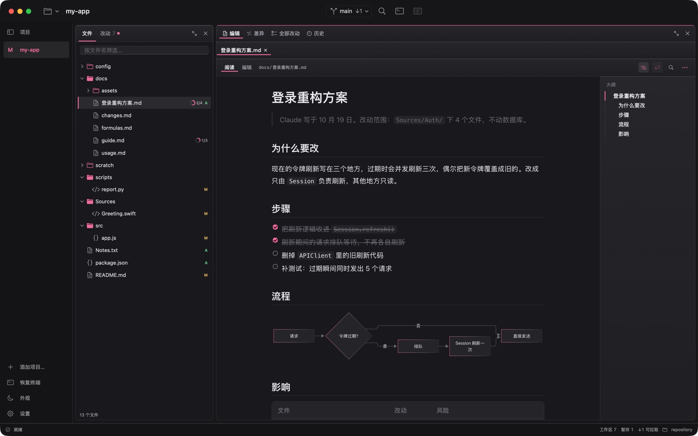
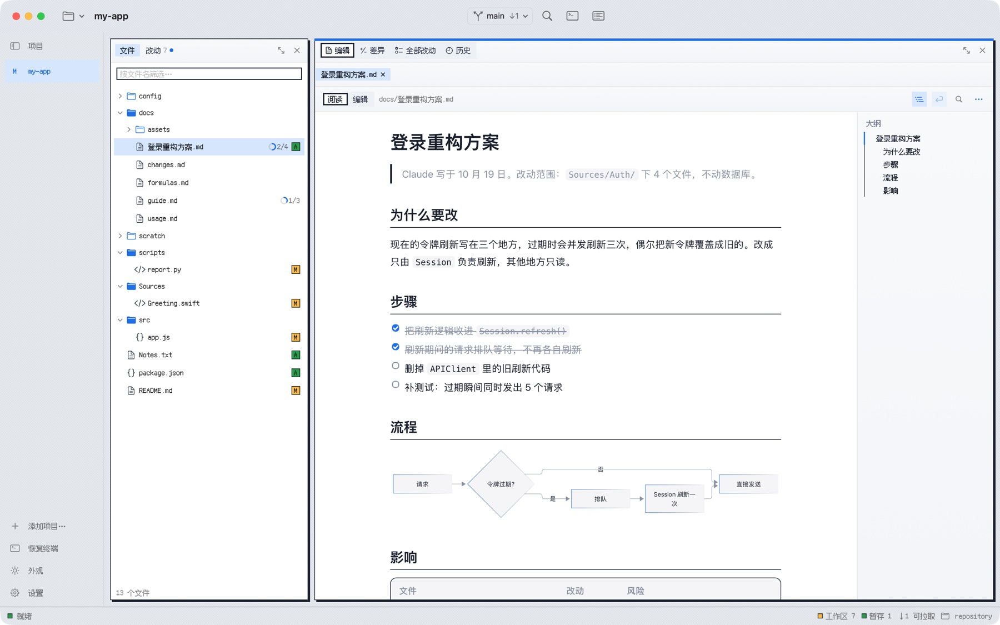

<div align="center">



# Folmi

**看清 AI 改了什么，一处一处决定留不留。**

一个 macOS 原生应用，主要配合 Claude Code 和 Codex。

[](https://github.com/fieai/Folmi/stargazers)
[](https://github.com/fieai/Folmi/releases)
[](LICENSE)


[官网](https://folmi.mindmesh.site) · [下载](https://github.com/fieai/Folmi/releases/latest) · [功能](#功能) · [对比](#和-cursorvs-code-有什么不同) · [从源码构建](#从源码构建) · [产品方向](docs/direction.md) · [更新记录](CHANGELOG.md)

</div>

<br>

<picture>
  <source media="(prefers-color-scheme: dark)" srcset="site/assets/shot-graphite-dark.jpg">
  
</picture>

## 为什么做 Folmi

AI 一轮对话能改几十个文件。一行行看完很累，闭着眼全收又不放心。

Folmi 把这一轮改动摊开：要紧的排在前面，看不懂的当场让 AI 解释，然后一处一处决定收下还是丢弃。每一步都能撤回，AI 的一整轮改动也能整批退回。

底下用的是 Git：收下就是暂存，没处理的留在工作区，不在 Git 之外另记一套状态。不太会 Git 也能用。

## 功能

### 验收 AI 的改动

| 按键 | 动作 |
| :---: | --- |
| <kbd>Space</kbd> | 看下一处 |
| <kbd>⏎</kbd> | 收下这一处 |
| <kbd>⌫</kbd> | 丢弃这一处 |
| <kbd>⌥</kbd> <kbd>⌘</kbd> <kbd>Z</kbd> | 撤销上一步 |

- **先看要紧的**：依赖、构建脚本、配置、大段删除排在前面，并写明为什么值得先看。
- **当场问**：选中一段，让 AI 解释这处改动，回答显示在改动旁边。
- **差异视图**：左右对照、全部改动连续滚动，可以按行或按块暂存。
- **审阅评论**：在改动旁写评论，一次发给终端里的 agent。

### 配合 Claude Code 和 Codex

- **按轮次记录**：钩子记下 AI 每一轮改了哪些文件，顶部显示「正在修改 / 改完了」。一整轮可以整批撤回，也可以在「全部改动」里只看这一轮。
- **危险命令拦截**：可选拦截 `git push`、`git reset --hard`、`git clean -f` 等命令。
- **MCP 服务**：agent 能读到你的审阅评论，处理完标成「已处理」，也能让 Folmi 打开指定的文件和行。
- **越用越顺手**：你反复丢弃的改动会归纳成规则提议，同意后写进 `CLAUDE.md` / `AGENTS.md`。

其他 AI 或你自己改的文件也能看、收、丢，只是不按轮次接入。

### 读和改 Markdown

- 阅读视图支持 KaTeX 公式和 Mermaid 图表，可以渲染差异、显示大纲、查看文档历史。
- 源码编辑辅助：表格里按 Tab 跳格、`/` 菜单、粘贴图片、`[[` 补全。

### 日常用到的其他功能

- 提交前检查，提交说明在后台预先写好；推送、拉取和冲突处理、分支、历史与提交图、暂放改动（stash）。
- 内嵌多标签终端、<kbd>⌘</kbd> <kbd>K</kbd> 命令面板、<kbd>⌘</kbd> <kbd>P</kbd> 快速打开、全文搜索、多项目。
- 四套主题：琥珀、锌莓、像素、石墨，各有浅色和深色。

<table>
  <tr>
    <td></td>
    <td></td>
    <td></td>
  </tr>
</table>

## 和 Cursor、VS Code 有什么不同

Cursor 和 VS Code 是用来写代码的编辑器；Folmi 是用来看 AI 改了什么、决定留不留的。三者可以一起开，不用二选一。

| | **Folmi** | Cursor | VS Code |
| --- | --- | --- | --- |
| 它是什么 | 看改动、收改动的 macOS 原生应用 | 带 AI 的代码编辑器，基于 VS Code | 通用代码编辑器，靠扩展接 AI |
| 谁来写代码 | 终端里的 Claude Code、Codex，或任何别的 AI | 主要是 Cursor 自带的 agent | Copilot 或其他扩展 |
| 看 AI 的改动 | 一处一处过，全用键盘；要紧的排在前面并写明原因 | 在编辑器里逐块接受或拒绝自带 agent 的改动 | 在差异编辑器里保留或撤销 Copilot 的改动 |
| 终端里 Claude Code / Codex 改的文件 | 按轮次接入：整批退回、按轮次看、拦危险命令 | 当作普通文件改动，在源代码管理面板里看 | 同左 |
| 反馈给 AI | 评论带文件和行号发回终端；反复丢弃的改动归纳成规则写进 `CLAUDE.md` / `AGENTS.md` | 在自带的对话里说 | 在 Copilot 对话里说 |
| AI 写的 Markdown | 默认阅读视图：公式、Mermaid、渲染后的差异 | Markdown 预览，公式和 Mermaid 通常要装扩展 | 同左 |
| 写代码本身 | 能改，但不做 LSP、格式化器、插件 | 完整的编辑、补全、调试、插件 | 同左 |
| 技术和体积 | Swift 原生，DMG 约 9 MB | Electron，安装包上百 MB | 同左 |

如果你主要在终端里用 Claude Code 或 Codex，Folmi 补上的是「看」这一步；写代码时还是用你顺手的编辑器。

## 安装

从 [Releases](https://github.com/fieai/Folmi/releases/latest) 或[官网](https://folmi.mindmesh.site)下载 DMG，把 Folmi 拖进「应用程序」。

> [!NOTE]
> 内测版已用 Developer ID 签名，但还没有完成 Apple 公证。第一次打开如果被系统阻止，请到「系统设置 → 隐私与安全性」点「仍要打开」。下载后可以用 `shasum -a 256` 对照 Release 里的校验值。

接入 agent：打开项目后，在命令面板（<kbd>⌘</kbd> <kbd>K</kbd>）里选「接入 agent」，按提示接入 Claude Code 或 Codex 的钩子和 MCP。

## 从源码构建

需要 macOS 14+、Xcode 16 或更高版本（Swift 6 工具链）。

```sh
git clone https://github.com/fieai/Folmi.git
cd Folmi
swift build
./scripts/test.sh
```

打包成 App，并用演示仓库试用（使用隔离的配置，不会碰你的真实项目和设置）：

```sh
./scripts/build-app.sh --editor-preview
open -n dist/Folmi-EditorPreview.app --args --demo --workspace-file /tmp/Folmi-Demo/workspace.json
```

`./scripts/build-app.sh` 不带参数时生成 `dist/Folmi.app`。有 Apple Development 证书时用它签名，否则做 ad-hoc 签名，只能在本机运行。

提交代码前建议跑一遍完整检查，包括编译、测试、性能门槛和打包：

```sh
./scripts/check.sh    # SKIP_PERF=1 跳过性能门槛
```

### 发版

改了什么写在 [CHANGELOG.md](CHANGELOG.md) 的「## 未发布」里（`python3 scripts/bump.py draft` 可以按提交起个草稿），然后一条命令：

```sh
./scripts/ship.sh minor    # 或 patch、major、0.8.0；--dry-run 先看每一步
```

它会跑测试，把 `VERSION` 和 CHANGELOG 改成新版本并打 tag，打包签名 DMG、发布到官网（官网的更新记录和版本号由 CHANGELOG 生成），推送，再建 GitHub Release。打包和上传用的 `deploy.sh` 等脚本不在仓库里，只在发版的机器上。

## 项目结构

```text
Sources/
├── Folmi/        App 本体（SwiftUI + AppKit）
├── FolmiCore/    Git 操作、差异、AI 事件、MCP 服务，不依赖界面
└── FolmiHook/    folmi-hook：Claude Code / Codex 的钩子程序和 MCP 入口
Tests/            FolmiCoreTests、FolmiTests
scripts/          构建、测试、性能、品牌资源导出
site/             官网页面
docs/             产品方向、设计说明、品牌资源
```

## 数据与隐私

- Folmi 自己不上传任何东西。只有用到解释改动、写提交说明这类 AI 功能时，相关内容才会发给你配置的模型，或者本机的 `claude`。
- 个人设置放在 `~/Library/Application Support/Folmi/`，目录权限 0700，文件权限 0600。API Key 存在系统钥匙串里。
- AI 的改动记录、审阅评论和你的决定放在各项目的 `.git/folmi/` 里，不会进入提交。
- 钩子和 MCP 只在你点「接入」并确认后才写入配置。

## 参与

欢迎提 [Issue](https://github.com/fieai/Folmi/issues) 和 Pull Request。提交 PR 前在本机跑一遍 `scripts/test.sh`；GitHub 上的 CI 会构建并跑核心测试。改动前可以先读一下 [产品方向](docs/direction.md)，里面写了哪些功能会做、哪些不做，以及原因。

## 致谢

- [SwiftTerm](https://github.com/migueldeicaza/SwiftTerm)：内嵌终端（MIT）
- [KaTeX](https://katex.org) 与 [Mermaid](https://mermaid.js.org)：Markdown 公式与图表（MIT）
- [Fusion Pixel](https://github.com/TakWolf/fusion-pixel-font)：像素主题字体（OFL-1.1）
- [One Dark Pro](https://github.com/Binaryify/OneDark-Pro)：编辑器配色（MIT）

第三方许可全文见 [licenses/](licenses/)。KaTeX、Mermaid 和字体都打包在 App 里，运行时不联网加载。

## 许可证

[MIT](LICENSE) © fieai
